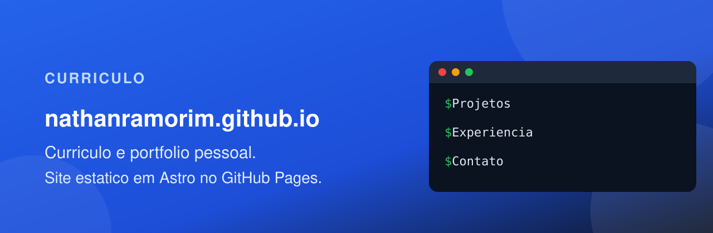

<p align="center">
  
</p>

<p align="center">
  <a href="https://github.com/nathanramorim/nathanramorim.github.io/releases"></a>
  
  
</p>

<h3 align="center">Currículo e portfólio pessoal.<br>Site estático em Astro, publicado no GitHub Pages.</h3>

---

## O que é

Site pessoal de Nathan Amorim: currículo, experiências, formação, certificações e projetos em destaque, publicado como site estático no GitHub Pages.

## Por que usar

| | |
|---|---|
| ⚡ **100% estático** | Build em Astro, sem servidor para manter. |
| 🗂️ **Conteúdo em dados** | Experiências, formação, certificações e projetos ficam em JSON em `src/data/sources/`, sem precisar tocar em código para atualizar. |
| 🔍 **SEO e sitemap** | Sitemap automático via `@astrojs/sitemap`. |

## Antes de começar

Node.js 22.12 ou mais novo.

## Instalação

```bash
npm install
```

## Como usar

```bash
npm run dev       # servidor local com hot reload
npm run build     # build estático de produção (dist/)
npm run preview   # serve o build de produção localmente
```

## Estrutura

```
src/
├── pages/                    rotas do site
├── layouts/                   layout base
├── presentation/components/   componentes visuais
├── domain/usecases/           casos de uso (ex.: GetFeaturedPosts)
└── data/sources/              conteúdo em JSON/TOML (experiências, skills, projetos, certificações...)
public/                       assets estáticos e favicon
```

## Versões

| Versão | Novidades |
|---|---|
| 0.1.0 | Primeira versão: currículo, projetos em destaque e blog. |
